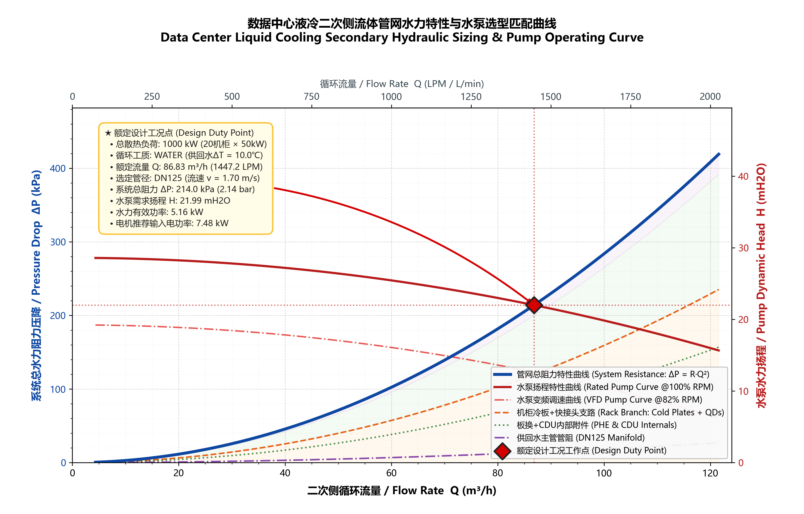

# 数据中心液冷二次侧流体管网水力计算与水泵选型工具
# Data Center Liquid Cooling Secondary Hydraulic Sizing & Pump Sizing Tool



本项目专为高密度数据中心液冷系统（DLC, Direct-to-Chip Liquid Cooling）二次侧管网设计打造，涵盖 **热平衡流量求解**、**基于达西-威斯巴赫（Darcy-Weisbach）方程与科尔布鲁克-怀特（Colebrook-White）精确迭代的主供回水集管水力比选**、**全管网设备部件阻力叠加（板换、CDU附件、快接头QD、冷板）**、**水泵扬程与轴功率推导**，以及 **标准选型计算书 CSV 导出与高精度工程特性曲线绘制**。

This engineering tool sizes the secondary-side hydraulic network for direct-to-chip (DLC) data-center cooling. It combines thermal flow sizing, Darcy-Weisbach pipe-loss calculations, Newton-iterated Colebrook-White friction factors, component pressure-drop aggregation, pump duty and power calculations, CSV reporting, and system/pump curve visualization.

---

## 目录 / Table of Contents
1. [系统回路架构与计算原理](#1-系统回路架构与计算原理)
2. [物理数学控制方程](#2-物理数学控制方程)
3. [项目模块化架构](#3-项目模块化架构)
4. [快速开始与使用指南](#4-快速开始与使用指南)
5. [默认计算结果与选型成果展示](#5-默认计算结果与选型成果展示)
6. [主要物理量符号与工程单位对照表](#6-主要物理量符号与工程单位对照表)

---

## 1. 系统回路架构与计算原理

数据中心二次侧（Secondary Loop）是指从 **冷量分配单元（CDU）** 经由 **机房供回水主管集管（Supply/Return Distribution Manifold）** 输送至各 **IT 算力机柜（Racks）**，并流经各服务器节点内部 **CPU/GPU 液冷板（Cold Plates）** 的闭式循环系统。

```
              ┌──────────────────────────────────────────────┐
              │           冷量分配单元 (CDU 模块)            │
              │   板式换热器 (PHE) + 双联过滤器 + 变频水泵   │
              └──────▲───────────────────────────────┬───────┘
                     │ (回水 Return)                 │ (供水 Supply)
       ┌─────────────┴───────────────────────────────▼─────────────┐
       │   主管集管 (Supply/Return Headers, DN50 ~ DN200 评估)      │
       └──────┬──────────────────────┬──────────────────────┬──────┘
              │ 支路 1               │ 支路 2               │ 支路 N (并联)
       ┌──────▼──────┐        ┌──────▼──────┐        ┌──────▼──────┐
       │ 机柜 1 (50kW)│        │ 机柜 2 (50kW)│        │ 机柜 20(50kW)│
       │  • 进出QD对  │        │  • 进出QD对  │        │  • 进出QD对  │
       │  • 机架RDM   │        │  • 机架RDM   │        │  • 机架RDM   │
       │  • 服务器冷板│        │  • 服务器冷板│        │  • 服务器冷板│
       └─────────────┘        └─────────────┘        └─────────────┘
```

各机柜支路呈 **水力并联布局**。依据流体网络基尔霍夫水力定律，管网总水阻由下式给出：
$$\Delta P_{total} = \Delta P_{HEX} + \Delta P_{CDU\_internals} + \Delta P_{manifold\_major} + \Delta P_{manifold\_minor} + \Delta P_{rack\_branch}$$

---

## 2. 物理数学控制方程

### 2.1 热平衡总循环流量推导 (Thermal Energy Conservation)
根据能量守恒定律，系统总热负荷由流体循环带走：
$$P_{total} = N_{racks} \cdot P_{rack}$$
$$\dot{m} = \frac{P_{total}}{C_p \cdot \Delta T}$$
$$Q = \frac{\dot{m}}{\rho} \quad [\text{m}^3/\text{s}]$$
$$Q_{\text{m}^3/\text{h}} = Q \times 3600, \quad Q_{\text{LPM}} = Q \times 60000$$

### 2.2 圆管平均流速与雷诺数 (Mean Velocity & Reynolds Number)
$$v = \frac{4 Q}{\pi D_{inner}^2}$$
$$Re = \frac{\rho \cdot v \cdot D_{inner}}{\mu} = \frac{v \cdot D_{inner}}{\nu}$$

- $Re \le 2300$: 层流状态 (Laminar)
- $2300 < Re \le 4000$: 过渡临界状态 (Transitional)
- $Re > 4000$: 充分发展紊流/湍流状态 (Turbulent)

### 2.3 达西摩擦阻力系数 $f$ (Darcy Friction Factor)
- **层流区** ($Re \le 2300$):
  $$f = \frac{64}{Re}$$
- **紊流区** ($Re > 4000$): 采用牛顿-拉弗森法精确求解隐式 **科尔布鲁克-怀特方程 (Colebrook-White)**：
  $$\frac{1}{\sqrt{f}} = -2 \log_{10}\left( \frac{\epsilon}{3.7 D} + \frac{2.51}{Re \sqrt{f}} \right)$$
  迭代初始估计值由哈兰德方程 (Haaland Explicit Formula) 给出：
  $$\frac{1}{\sqrt{f_0}} = -1.8 \log_{10}\left[ \left(\frac{\epsilon/D}{3.7}\right)^{1.11} + \frac{6.9}{Re} \right]$$

### 2.4 沿程阻力损失 (Darcy-Weisbach Major Loss)
$$\Delta P_{major} = f \cdot \frac{L}{D} \cdot \frac{\rho v^2}{2} \quad [\text{Pa}]$$
比摩阻（单位长度沿程压降）：
$$\left(\frac{\Delta P}{L}\right) = f \cdot \frac{1}{D} \cdot \frac{\rho v^2}{2} \quad [\text{Pa/m}]$$

### 2.5 局部阻力损失 (Minor Head Loss)
$$\Delta P_{minor} = \sum K_i \cdot \frac{\rho v^2}{2} \quad [\text{Pa}]$$

### 2.6 水头扬程与有效水力功率 (Pump Head & Power)
$$H = \frac{\Delta P_{total}}{\rho \cdot g} \quad [\text{mH}_2\text{O}]$$
$$P_{hyd} = Q \cdot \Delta P_{total} \quad [\text{kW}]$$
$$P_{shaft} = \frac{P_{hyd}}{\eta_{pump}}, \quad P_{electric} = \frac{P_{shaft}}{\eta_{motor}}$$

---

## 3. 项目模块化架构

```
E:\freeworld\02_Construction_Site\hydraulic_sizing_tool\
├── config/
│   ├── __init__.py
│   └── parameters.py        # 默认参数、标准管径库(DN50~DN200)、局部阻力配置
├── core/
│   ├── __init__.py
│   ├── fluid_props.py       # 去离子水(WATER)、25%丙二醇(PG25)、25%乙二醇(EG25)精确热物性
│   ├── hydraulics.py        # 达西-威斯巴赫方程、Colebrook-White迭代求解器、流速与局部阻力
│   └── sizing_engine.py     # 热平衡流量求解、集管流速评估推荐、全系统阻力叠加、曲线生成
├── reporting/
│   ├── __init__.py
│   ├── csv_exporter.py      # 标准选型计算书 CSV 导出 (UTF-8 with BOM，完美兼容 Excel)
│   └── visualizer.py        # Matplotlib 绘制 流量 vs 系统阻力/水泵扬程特性曲线
├── assets/
│   └── system_curve.png     # 300 DPI 高清工程特性曲线图
├── sizing_report.csv        # 自动生成的选型计算书
├── main.py                  # CLI 命令行入口
├── run_sizing.bat           # Windows 一键执行批处理脚本
└── README.md                # 详细工程说明文档
```

---

## 4. 快速开始与使用指南

### 4.1 一键运行 (默认参数: 20机柜, 50kW/机柜, ΔT=10℃, 去离子水)
需要 Python 及 `numpy`、`matplotlib`。首次运行前可安装依赖：
```powershell
python -m pip install numpy matplotlib
```

Run from the project root. Double-click `run_sizing.bat`, or use either command below:
```powershell
python main.py
.\run_sizing.bat
```

### 4.2 常用自定义运行示例 (CLI and batch parameters)

**切换为 25% 乙二醇/丙二醇水溶液 (PG25)**：
```powershell
python main.py --fluid PG25
.\run_sizing.bat --fluid PG25
```

**调整机柜规模与单机柜功率 (如 30 个 60kW 算力柜，供回水温差 12℃)**：
```powershell
python main.py --racks 30 --power 60 --delta_t 12 --fluid WATER
.\run_sizing.bat --racks 30 --power 60 --delta_t 12 --fluid WATER
```

**指定特定管径规格 (如强制指定 DN150 主管)**：
```powershell
python main.py --pipe_dn DN150
.\run_sizing.bat --pipe_dn DN150
```

**自定义输出文件路径**：
```powershell
python main.py --csv my_report.csv --plot assets/my_curve.png
```

`run_sizing.bat` forwards all arguments to `main.py`. Supported options include `--racks`, `--power`, `--delta_t`, `--fluid` (`WATER`, `PG25`, `EG25`), `--supply_temp`, `--pipe_dn`, `--csv`, and `--plot`. The default run writes `sizing_report.csv` and `assets/system_curve.png`.

---

## 5. 默认计算结果与选型成果展示

### 5.1 额定工况设计结果 (默认 20机柜 × 50kW = 1000kW, 去离子水, ΔT=10℃)

| 参数项 | 数值 | 单位 | 说明 |
| :--- | :--- | :--- | :--- |
| **总循环流量 $Q$** | **86.83** | $\text{m}^3/\text{h}$ | $1447.2\text{ LPM}$ (每台机柜 $72.36\text{ LPM}$) |
| **推荐主集管** | **DN125** | - | 外径 141.3mm, 壁厚 3.5mm, 内径 134.3mm |
| **主集管流速 $v$** | **1.70** | $\text{m/s}$ | 位于 ASHRAE/OCP 最佳经济推荐流速区间 ($1.2 \sim 2.0\text{ m/s}$) |
| **系统管网总阻力 $\Delta P$** | **213.99** | $\text{kPa}$ | 约 **$2.14\text{ bar}$** |
| **水泵额定设计工况点** | **86.83 / 21.99** | $\text{m}^3/\text{h} \; / \; \text{mH}_2\text{O}$ | 设计流量 / 设计扬程；采购时应以厂家泵曲线校核 |
| **水力有效功率 $P_{hyd}$** | **5.16** | $\text{kW}$ | $Q \times \Delta P$ |
| **水泵轴功率需求 $P_{shaft}$** | **6.88** | $\text{kW}$ | 按水泵效率 75% 计算 |
| **电机输入功率需求** | **7.48** | $\text{kW}$ | 按电机效率 92% 计算；对应标准 7.5 kW 电机配置，最终以厂家选型为准 |

主管选型按项目采用的 **ASHRAE TC 9.9 经济流速参考范围 1.2–2.0 m/s** 进行评估：DN125 内径 134.3 mm 时流速为 1.70 m/s，满足该范围并在阻力与管材投资之间取得平衡。该筛选范围是本工具采用的工程设计准则，项目实施时仍应结合适用规范、管材及设备厂家要求复核。

For the project design criterion, the ASHRAE TC 9.9-referenced economic velocity range is 1.2–2.0 m/s. DN125 (134.3 mm ID) yields 1.70 m/s and is selected as the balance between hydraulic loss and pipe investment. Confirm final sizing against applicable codes and manufacturer data.

### 5.2 系统各部件阻力拆解构成

```
[机柜内部服务器冷板及分配管] ■■■■■■■■■■■■■■■■■■■■■■■■ 80.0 kPa (37.4%)
[板式换热器二次侧阻力]        ■■■■■■■■■■■■■ 45.0 kPa (21.0%)
[CDU内部过滤器/止回阀/附件]   ■■■■■■■■■■ 35.0 kPa (16.4%)
[机柜级快接头对阻力 (进+回)]  ■■■■■■■ 25.0 kPa (11.7%)
[机柜支路平衡调节阀与软管]    ■■■■ 15.0 kPa (7.0%)
[供回水主管沿程阻力 (DN125)]  ■■■ 9.1 kPa (4.3%)
[供回水主管管件局部阻力]      ■■ 4.9 kPa (2.3%)
```

### 5.3 管网水力与水泵特性曲线 (`assets/system_curve.png`)
生成的特性曲线图清晰标注：
- **管网总阻力特性曲线**：$\Delta P(Q) = R_{sys} \cdot Q^2$
- **离心水泵额定工况扬程特性曲线** (100% RPM) 与 **变频调速曲线** (82% RPM)
- **额定设计工况点 (Design Duty Point)**：十字参考线与详细物理参数浮动卡片
- **分项阻力贡献**：冷板支路、板换及CDU附件、主管沿程阻力半透明填充区

---

## 6. 主要物理量符号与工程单位对照表

| 物理量名称 | 英文名称 / Symbol | 国际单位 (SI) | 常用工程单位 |
| :--- | :--- | :--- | :--- |
| 热负荷 | Thermal Duty / $P$ | $\text{W}$ | $\text{kW}, \text{MW}$ |
| 循环质量流量 | Mass Flow Rate / $\dot{m}$ | $\text{kg/s}$ | $\text{t/h}$ |
| 循环体积流量 | Volumetric Flow / $Q$ | $\text{m}^3/\text{s}$ | $\text{m}^3/\text{h}, \text{LPM}$ |
| 流速 | Fluid Velocity / $v$ | $\text{m/s}$ | $\text{m/s}$ |
| 达西阻力系数 | Darcy Friction Factor / $f$ | - | 无量纲 |
| 雷诺数 | Reynolds Number / $Re$ | - | 无量纲 |
| 动压 | Dynamic Pressure / $P_d$ | $\text{Pa}$ | $\text{kPa}$ |
| 系统阻力压降 | Pressure Drop / $\Delta P$ | $\text{Pa}$ | $\text{kPa}, \text{bar}, \text{psi}$ |
| 水泵扬程 | Pump Dynamic Head / $H$ | $\text{m}$ | $\text{mH}_2\text{O}$ |
| 动力粘度 | Dynamic Viscosity / $\mu$ | $\text{Pa}\cdot\text{s}$ | $\text{mPa}\cdot\text{s}, \text{cP}$ |
| 流体密度 | Fluid Density / $\rho$ | $\text{kg/m}^3$ | $\text{g/cm}^3$ |
